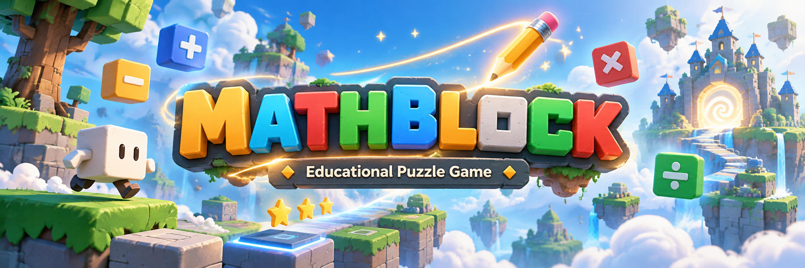

<p align="center">
  
</p>

<div align="center">

# 🎮 MATHBLOCK

### Learn mathematics. Solve puzzles. Explore new possibilities.

**A 3D educational puzzle game combining mathematics, logical reasoning, and interactive challenges.**


<br>


<br>

**[About](#-about-the-project) • [Gameplay](#-gameplay) • [Stages](#-explore-the-four-stages) • [Technologies](#-built-with) • [Team](#-meet-the-team) • [Getting Started](#-getting-started)**

</div>

---

## 🌈 About the Project

> **What if mathematics became part of the world around you?**

**MATHBLOCK** is a 3D educational game developed as a high school final project (TCC), designed to reinforce fundamental mathematical concepts and encourage logical reasoning among elementary school students.

The project originated from our observations of students struggling with basic mathematics and often showing little interest in conventional learning approaches.

Rather than replacing classroom education, MATHBLOCK aims to **complement the learning experience** by making mathematical reasoning an essential part of gameplay.

Set in a dreamlike world, players wield a **magical pencil** capable of manipulating numbered blocks and applying mathematical operations to them.

By changing the values of these blocks, players solve puzzles, overcome obstacles, and discover new paths through the environment.

---

## 🧩 Gameplay

<div align="center">

### 🪄 One magical pencil. Four operations. Endless possibilities.

</div>

The gameplay combines **exploration, platforming, mathematical problem-solving, and environmental interaction**.

### 🔢 Mathematical Operations

| Operation | Symbol | |
|:---:|:---:|:---|
| Addition | ➕ | Increase numerical values |
| Subtraction | ➖ | Decrease numerical values |
| Multiplication | ✖️ | Multiply numerical values |
| Division | ➗ | Divide numerical values |

The game does not use blocks with zero or negative values.

### 🎯 Core Mechanics

| 🧠 Mathematical Puzzles | 🪄 Block Manipulation |
|:---|:---|
| Solve challenges using mathematical reasoning and basic operations. | Use the magical pencil to interact with numbered blocks and modify their values. |

| 🏃 Platforming & Exploration | ⏱️ Environmental Challenges |
|:---|:---|
| Move, jump, explore, and navigate different environments. | Overcome doors, moving platforms, obstacles, and time-based challenges. |

---

## 🗺️ Explore the Four Stages

Each stage introduces new challenges while building upon previously learned mechanics.

### 🟦 Stage 01 — Fundamentals

**Learn the basics. Discover your abilities.**

The journey begins with an introduction to movement, jumping, numbered blocks, and the magical pencil.

Players explore the four basic mathematical operations and use them to solve puzzles and open three doors.

**Main concepts:** Basic operations · Movement · Block manipulation

---

### 🟩 Stage 02 — Scaling Blocks

**Change the numbers. Change the world.**

A new type of block is introduced: one that changes its physical size according to its numerical value.

Players must use mathematical operations to resize blocks and overcome environmental obstacles.

**Main concepts:** Numerical values · Scaling · Spatial reasoning

---

### 🟨 Stage 03 — Equation Balance

**Find the balance. Understand equality.**

Large interactive balancing scales introduce the concept of mathematical equality.

Players must reason about numerical equivalence and manipulate blocks to balance the structures and unlock new paths.

**Main concepts:** Equality · Equivalence · Logical reasoning

---

### 🟥 Stage 04 — Final Challenge

**Everything you've learned. One final test.**

The final stage combines the mechanics introduced throughout the game.

Players must solve mathematical expressions and navigate an arena featuring obstacles, time pressure, and increasingly demanding challenges.

**Main concepts:** Mathematical expressions · Problem-solving · Time management

> 🚧 **Development note:** Stage 4 is currently under development.

---

## 🛠️ Built With

<div align="center">

### Technologies & Development Tools


</div>

| Technology | Purpose |
|---|---|
| **Unity 6** | Game engine and scene development |
| **C#** | Gameplay mechanics and systems |
| **Blender** | 3D modeling and environment assets |
| **FMOD** | Audio implementation |
| **Git & GitHub** | Version control and collaboration |

The development workflow also incorporates AI-assisted programming tools, a project knowledge base, and native MCP integration with the Unity Editor.

---

## 🏆 Academic Recognition

<div align="center">

### 🥉 3rd Place — IFTECH

**Qualified for the State-Level Stage**

</div>

MATHBLOCK was developed as a high school final project (TCC).

The project achieved **third place at IFTECH**, advancing to the state-level stage of the event.

This recognition marked an important milestone in the project's development and presentation.

---

## 🧪 Testing & Feedback

MATHBLOCK has undergone informal playtesting sessions with students from our institution and members of its intended audience.

During testing, the development team:

- 👀 Observed how participants interacted with the game.
- 💬 Asked players about their experiences.
- 📝 Recorded feedback and difficulties.
- 🔧 Used observations to guide improvements.

These sessions help identify opportunities to improve usability, gameplay, and the clarity of mathematical challenges.

> **Note:** These were exploratory playtesting sessions, not a formal study of educational effectiveness.

---

## 🚀 Development Status

<div align="center">

### 🚧 In Development

**Playable version available**

</div>

MATHBLOCK is still being developed and refined.

Currently:

- ✅ Playable through the Unity Editor.
- ✅ Functional Android APK build.
- 🔒 Android version not publicly distributed.
- 🚧 Stage 4 under development.
- 🔧 Gameplay improvements and bug fixes ongoing.

### 📌 Roadmap

- [ ] Complete Stage 4
- [ ] Fix identified bugs
- [ ] Improve visual presentation
- [ ] Refine gameplay mechanics and interactions
- [ ] Prepare the final version of the project

---

## 👥 Meet the Team

MATHBLOCK is a collaborative project developed through contributions across programming, game design, 3D modeling, and audio production.

| Team Member | Responsibility |
|---|---|
| **Yan Vinicius** | Project Lead & Programmer |
| **Samuel Sbaraine** | Programmer |
| **Kauan Calefi** | Sound Development |
| **Lucas Vieira** | 3D Artist |
| **Leandro Piasseta** | Designer |

Every area of development contributes to the game's mechanics, atmosphere, and overall experience.

---

## ▶️ Getting Started

### Requirements

- Unity Hub
- **Unity Editor 6000.3.9f1**
- Git

### Running in Unity

**1. Clone the repository**

```bash
git clone https://github.com/Yanszpereira/MATHBLOCK.git
```

**2. Open the project**

Open Unity Hub and select **Add project from disk**.

Choose the following directory:

```text
MATHBLOCK/ProjetoMATHBLOCK
```

**3. Select the Unity version**

Open the project using **Unity 6000.3.9f1**.

Wait for Unity to import the assets and resolve the necessary packages.

**4. Run the game**

Open the scene:

```text
Assets/Scenes/MainMenu.unity
```

Enter **Play Mode** to start.

> ⚠️ Some features or development stages may require additional configuration.

---

<div align="center">

### 🧠 Learn. Experiment. Solve.

**MATHBLOCK — Making mathematics part of the adventure.**

🎮 🧩 ➕ ➖ ✖️ ➗

</div>
